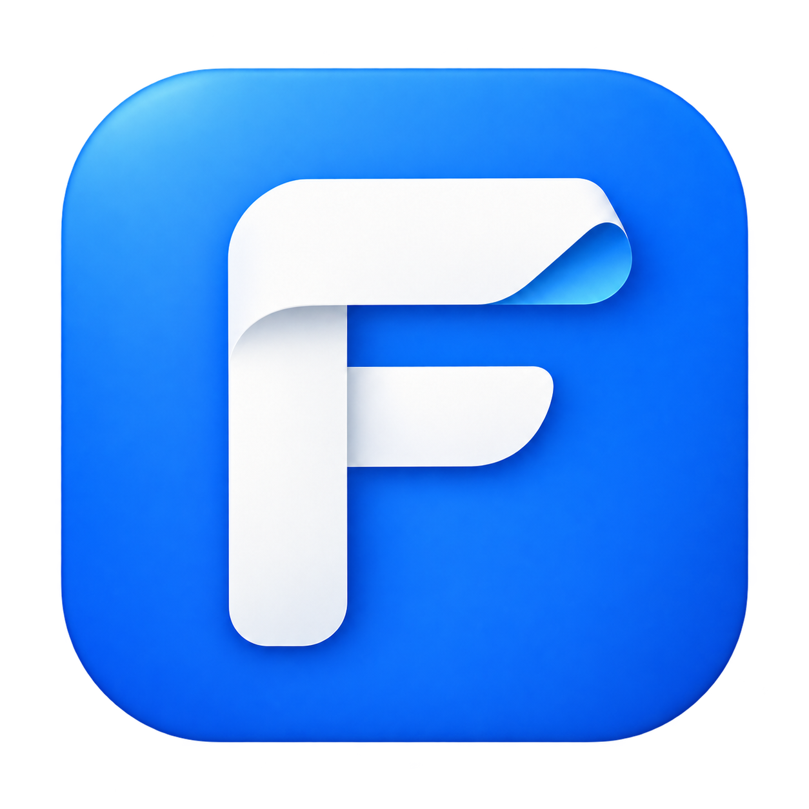

<p align="center"></p>

# FoldBar

[简体中文](README.md) · [Website](https://foldbar.cmmuu.com/en/) · [Download](https://downloads.cmmuu.com/download/foldbar/latest/macos-arm64) · [GitHub releases](https://github.com/CMMUU/foldbar/releases/latest)

A calmer menu bar. FoldBar is a native menu bar manager for **macOS 27 on Apple Silicon**. Fold the apps you use less, open their icons in a popover, or manage everything in one window.

Version **0.3.0** is an early preview. Published installers are Developer ID signed and notarized by Apple.

## Get started

1. Open the DMG, drag FoldBar to Applications, then launch it.
2. Grant FoldBar Accessibility permission in System Settings, then click **Check Again**.
3. Select one app, several apps, or all matching results. Choose pinned or folded, then **Apply**. System items are read-only.
4. Click **F** in the menu bar to open the popover. Switch between Folded and All, search, open an original menu, or choose **Manage All**.
5. Select **System Default / 简体中文 / English** in the manager to switch languages immediately.

Changes can be cancelled or undone, including the previous applied configuration. Temporary expansion preserves saved choices. Opening an original menu briefly expands the bar; folding resumes when the menu closes. Preferences stay on your Mac, with no telemetry or Screen Recording permission.

If macOS hides FoldBar's own status item, an independent fallback **F** button appears below the top-right edge. Reopening the app also brings back the manager. Right-click F to manage apps, expand temporarily, or quit. Quitting releases the folding session.

## Current limitations

- Folding is per app. Multiple status items from the same app fold together; detected items can be selected when opening a menu.
- Uses private macOS 27 menu bar APIs. Other major macOS versions are unsupported and future updates may affect compatibility.
- System items are read-only. Some system extras, including media controls, may disappear while folded and return on expansion.
- The popover displays app icons rather than live replicas of status items.
- The primary-display workflow has preview validation; multi-display, full-screen and long-running behavior need further testing.
- Custom ordering, launch at login, global shortcuts, conditional rules and automatic updates are not included yet.

## Build and test

The app requires Apple Silicon, macOS 27 and its Xcode SDK. It uses Swift, SwiftUI, AppKit and a small Objective-C runtime bridge, without third-party app dependencies.

```sh
swift test
bash scripts/build.sh
open build/FoldBar.app
```

The script uses ad-hoc signing by default. Set `FOLDBAR_SIGN_IDENTITY` to your own Developer ID identity for distribution. No signing keys or notarization credentials are stored in this repository. A different signature or installation path may require Accessibility permission again.

Core tests cover bulk scope, read-only exclusion, cancellation, undo, applied history and language selection. `--ui-test` uses isolated preferences; `--fixture` creates test status items; `--smoke-test` targets only `com.cmmuu.FoldBar.Fixture` and requires Accessibility permission for the testing process.

Report bugs through [Issues](https://github.com/CMMUU/foldbar/issues), with your macOS version, chip and reproduction steps. Avoid sharing private menu content.

Interaction research references [Bartender](https://www.macbartender.com/); technical references include [NSStatusBar](https://developer.apple.com/documentation/appkit/nsstatusbar), [Thaw architecture](https://github.com/thaw-app/Thaw/blob/development/docs/ARCHITECTURE.md) and [Pelmet](https://github.com/fif7y/pelmet). FoldBar is independently implemented and is not affiliated with those products.
